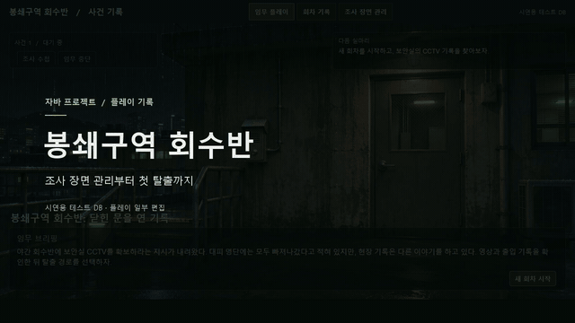

# 봉쇄구역 회수반

Java Swing과 Oracle JDBC를 연결한 1인 방탈출 프로젝트입니다. 구역의 단서를 읽고 퍼즐을 풀며 증거를 원본 또는 복사본으로 가져옵니다. 원본을 들면 빈 손이 줄어들고, 경로와 증거에 따라 결말이 달라집니다.

## 시연 영상

미리보기를 누르면 전체 시연 영상(4분 49초)을 열 수 있습니다.

## 실행 방법

1. SQL Developer에서 테이블 생성 권한이 있는 Oracle 스키마에 접속합니다.
2. 새 스키마에서는 폴더 안의 `sql/1_테이블 생성.sql`과 `sql/2_기본 데이터 입력.sql`을 차례로 엽니다. 각 파일은 스크립트 실행(F5)으로 한 번씩 실행합니다. 프로젝트 테이블과 사건 1을 이미 준비한 계정은 해당 계정으로 접속하면 됩니다.
3. IntelliJ IDEA에서 `pom.xml`을 Maven 프로젝트로 열고 Project SDK에 JDK 17 이상을 지정합니다. Maven이 `ojdbc17`을 불러온 뒤 `src/main/java/kr/recovery/Main.java`의 메인 메서드를 실행합니다.
4. 게임의 Oracle 접속 화면에 SQL을 실행한 Oracle 서버의 JDBC 주소와 계정명 및 비밀번호를 입력합니다. 로컬 Oracle XE의 주소 예시는 `jdbc:oracle:thin:@localhost:1521/xe`입니다.

## 시연 방법

- **임무 플레이**에서 새 회차를 열고 사진 속 문과 물건을 직접 눌러 조사합니다. 커서가 조사 대상에 가까워지면 대상 이름이 표시됩니다. 사진에 초점을 둔 뒤 좌우 화살표와 Enter로도 조사할 수 있습니다.
- 화면 오른쪽 위 **다음 실마리**에서 어디를 살펴볼지 확인합니다. 발견한 대사와 단서, 퍼즐 입력 및 회수 선택은 사진 아래 창에 표시됩니다. 퍼즐에 연결된 단서를 모두 읽어야 답안을 제출할 수 있고, 다시 보고 싶은 단서는 조사 수첩에서 확인할 수 있습니다.
- 단서를 닫기 전에 물건의 확대 화면에서 중요한 문구와 기록을 읽을 수 있습니다. 퍼즐 화면의 **대조할 곳**에는 관련 기록 이름과 비교할 내용이 나오고, **관련 단서 보기**에서 해당 물건들만 다시 볼 수 있습니다.
- 시연이나 테스트 중 퍼즐에서 막히면 **정답·해설 보기**를 누릅니다. 창을 닫고 답을 직접 입력하면 진행되며, 정답을 보는 것만으로는 제출 횟수가 늘어나지 않습니다.
- 대화 중에는 게임 화면 어디든 한 번 누르면 다음 대사가 나옵니다. 마지막 대사에서 한 번 더 누르면 조사로 돌아갑니다. Space와 Enter로도 넘길 수 있습니다.
- 회수를 확정한 증거는 방에서 사라지며, 같은 방의 **조사 수첩 → 증거 보관함**에서 원본과 복사본을 바꾸거나 원본을 내려놓을 수 있습니다.
- **회차 기록**에서 저장된 회차를 조회하고 해결 퍼즐, 제출 횟수, 증거 형태를 확인합니다. 임무를 정상적으로 중단하면 실패 이력이 기록됩니다. 강제 종료된 진행 중 회차는 진행 중으로 표시됩니다.
- **조사 장면 관리**에서 최초 한 번 ‘시연 공간 준비’를 누릅니다. 종류, 제목, 내용을 넣어 등록하고 목록을 조회합니다. 목록에서 행을 선택하면 수정·삭제할 수 있습니다. 별도 시연 사건 번호 `900000001`을 사용합니다.
- 기존 Oracle 사건으로 로그인해도 초기에 입력한 기본 문장은 개정 문구로 표시됩니다. 직접 고쳐 입력한 문장은 DB에서 읽은 그대로 표시합니다.

## 배경 이미지

`src/main/resources/rooms`에 여섯 구역의 개별 배경 사진(1774×887)을 넣었습니다. 사진 속 인터폰, 상황판, 계기판, 문 등이 실제 조사나 이동의 대상입니다. 사진 위에 반투명하게 겹치는 패널에서 실마리와 대사, 조사 수첩을 확인할 수 있습니다.
